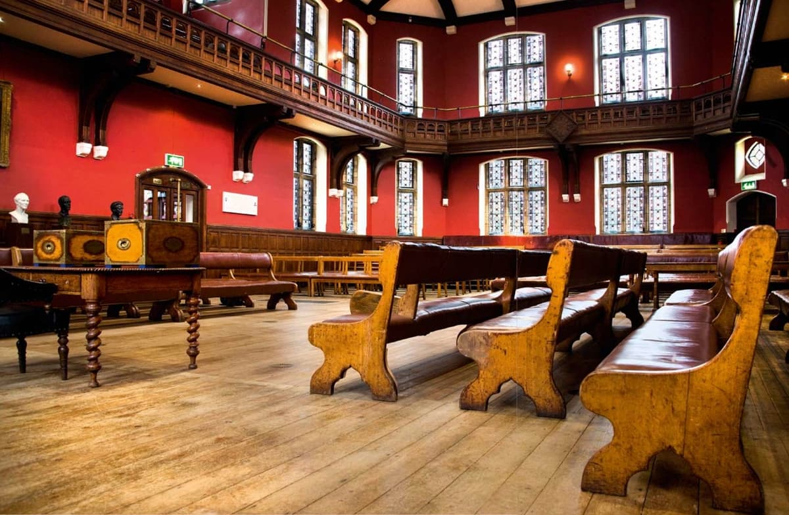
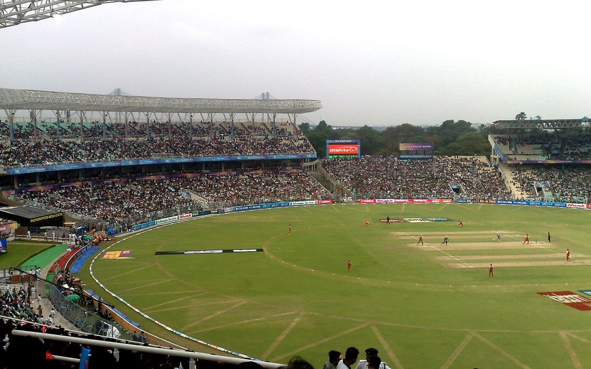

Lalit Modi, the man who built the Indian Premier League and then left the country at the height of its success, is now a British citizen. He made the announcement himself on Saturday, 14 November, first in a talk at the Oxford Union and then in a post on X.

Modi said he took citizenship on 15 September 2026 at a ceremony attended by family and friends, and held the news back for two months. The date he picked to go public was not random. It was King Charles III's birthday, and he ended his post with "God Save the King!"

## Key points

- Modi says he became a British citizen on 15 September 2026 and announced it on 14 November.
- He left India in 2010, soon after being suspended as IPL chairman, and has lived in the UK since.
- In July, an appellate tribunal set aside most of the Enforcement Directorate's findings against him in the 2009 IPL South Africa case.
- He has said he plans to visit India around the end of this year or early next year.

## What Lalit Modi said

His post opened in capitals: "A PROUD MOMENT. A NEW CHAPTER." He wrote that the United Kingdom had been his home for many years and that he had come to admire its people, institutions, traditions and values.

He called citizenship "a privilege and a responsibility", one he said he accepts with "pride, gratitude and a genuine sense of belonging". He thanked his family, his friends and the Oxford Union, added that he hopes to contribute to the country he now calls home, and signed off as "Founder IPL".

The Oxford Union had listed him as an afternoon speaker and described him as the founder of a league now valued at more than $20 billion.

<figure>
  
  <figcaption>The debating chamber of the Oxford Union, where Modi spoke on 14 November. Photo: Barker Evans / Wikimedia Commons (Free Art Licence)</figcaption>
</figure>

## From IPL boss to 16 years abroad

Modi launched the IPL in 2008 as its first chairman and commissioner. The idea was simple and, at the time, untested in cricket: city-based franchises, private owners, player auctions and a short format made for television. It worked faster than almost anyone expected.

The fall was just as quick. He was suspended by the Board of Control for Cricket in India (BCCI) in April 2010, right after that season's final, over allegations of financial irregularities. He left for London soon afterwards. In 2013 the BCCI banned him for life, citing misconduct and indiscipline.

Modi has always denied wrongdoing. He has said he left India because of threats to his safety, not to avoid investigators.

<figure>
  
  <figcaption>Eden Gardens in Kolkata during an IPL match in 2011. Photo: Suraj100 / Wikimedia Commons (public domain)</figcaption>
</figure>

## Where the cases against him stand

The main case concerned the 2009 season, which was moved to South Africa because it clashed with India's general election. The Enforcement Directorate (ED) alleged that payments made to stage the tournament abroad broke the Foreign Exchange Management Act (FEMA), and penalties were imposed on Modi and others.

In July this year, the appellate tribunal that hears such cases set aside most of the ED's findings and penalties against Modi and the other appellants. He called it the end of a 16-year fight. Reports at the time noted it was not yet clear whether the ED would challenge the order, and that question is still open.

## The passport trail

This is not Modi's first change of nationality. In March 2025, India's foreign ministry confirmed he had applied at the High Commission in London to give up his Indian passport after acquiring citizenship of Vanuatu, a Pacific island nation. The ministry said at the time that it would continue to pursue the case against him as required by law.

Within days, Vanuatu's prime minister ordered that passport to be cancelled, saying citizenship of the country was a privilege and not a right.

British citizenship is a different matter. Applicants normally need several years of lawful residence and have to meet a good-character requirement before they are approved.

## What it means for his return to India

India does not allow dual citizenship, so Modi would travel as a foreign national. That means he would need a visa or an Overseas Citizen of India card to enter the country he once ran cricket in.

After the tribunal order in July, he said: "I will come back probably end of this year or early next year." He has also indicated that London will remain his main home, so any trip is likely to be a visit and not a permanent move.

We have not seen any official response from the Indian government to his announcement so far.

## Why it matters for the business of cricket

Whatever one thinks of Modi, the league he designed changed the economics of the sport. Franchise valuations, media rights and player salaries in the IPL now sit alongside those of the biggest leagues in the world, and nearly every cricket board has tried to copy the model.

Modi has stayed a loud voice on where the league should go next. Earlier this month he floated the idea of a second, winter IPL window, which drew public support from industrialist Harsh Goenka. With a British passport and most of the ED case behind him, he is likely to be heard from more, not less.

*This report is based on Lalit Modi's public post on X and reporting by ANI, Business Today, India TV and The Tribune.*
