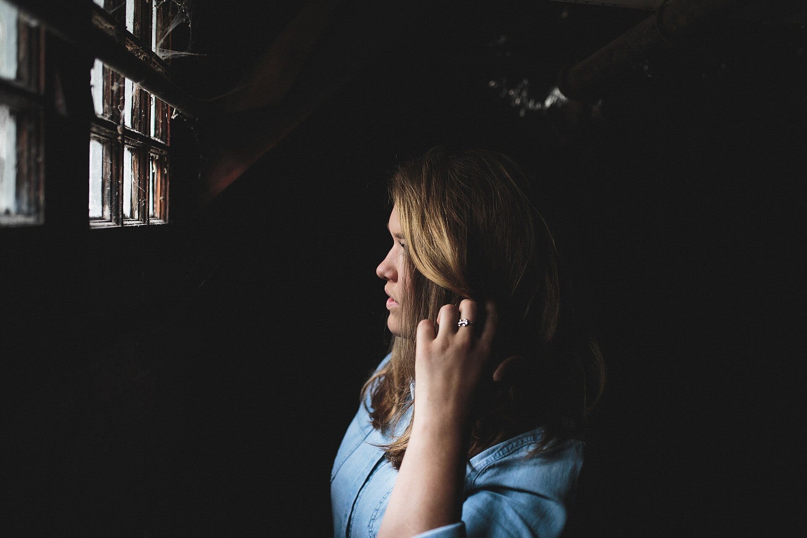

Most people know what to do about a fever that will not go away. Far fewer know what to do when it is their sleep, their mood or their ability to concentrate that has been off for weeks.

A short guide from the American Psychiatric Association Foundation, reviewed by psychiatrist Dr Vedrana Hodzic, tries to close that gap. It lists six common signs of a possible mental health concern and gives one simple rule: if several of them have lasted more than two weeks and are getting in the way of daily life, it is time to talk to someone.

The guide was written for readers in the United States. The signs are the same everywhere, though, and India now has its own free routes to care. Here is what to look for and where to turn.

## Key points

- Warning signs rarely show up alone. Doctors look for a cluster of changes that lasts more than two weeks.
- The six signs cover sleep and appetite, social withdrawal, work or school performance, thinking, personal care and intense worry.
- In India, the government's Tele MANAS helpline on **14416** is free and open all day, every day.
- Indian law requires health insurers to cover mental illness on the same basis as physical illness.

## The six signs to watch for

According to the foundation's guide, these are the changes worth paying attention to:

1. **Sleep or appetite changes.** Sleeping or eating much more, or much less, than usual.
2. **Pulling away from people.** Avoiding friends and family, or losing interest in things you used to enjoy.
3. **Slipping at work or school.** A drop in performance that is out of character.
4. **Trouble thinking clearly.** Problems concentrating, forgetting things, or thoughts and speech that feel jumbled and are hard to explain.
5. **Neglecting personal care.** Letting go of bathing, dressing and other everyday hygiene.
6. **Intense worry or fear.** Sudden, overwhelming fear for no clear reason, or a nervous feeling that does not go away.

None of these is a diagnosis. Everyone has a bad week, and a single sign on its own usually means little. What matters is the pattern.

## Why two weeks matters

The guide makes a point that is easy to miss: the symptoms doctors use to identify conditions such as depression or anxiety rarely appear in isolation. They tend to come together, last longer than a couple of weeks, and disturb a person's routine.

That is a useful test to apply to yourself or someone close to you. A rough few days after a setback is ordinary. Three weeks of poor sleep, skipped meals and cancelled plans is a reason to ask for help.

<figure>
  
  <figcaption>Withdrawing from friends and family is one of the six signs. Photo: Andrew Neel / Unsplash via Wikimedia Commons (CC0)</figcaption>
</figure>

## How to get help in India

The foundation's advice is to start with a doctor you already know. The same approach works here.

**Start with your regular doctor.** A family physician or general practitioner can talk through what you are experiencing, rule out physical causes such as thyroid problems, and refer you to a psychiatrist or psychologist if needed.

**Call Tele MANAS on 14416.** This is the government's national tele mental health service, launched in October 2022. It is free, runs round the clock, and connects callers to trained counsellors in several Indian languages. The helpline handled more than 23.8 lakh calls between its launch and March 2025, according to a government reply in Parliament.

**Check your health insurance.** Section 21(4) of the Mental Healthcare Act, 2017 says every insurer must provide cover for the treatment of mental illness on the same basis as physical illness. The insurance regulator, IRDAI, told insurers to comply in August 2018. In practice, policies still vary. A 2024 study of 268 policies, published in the Indian Journal of Medical Ethics, found six that excluded mental illness outright. Read the policy wording and ask your insurer directly what is covered.

**If cost is a worry.** Government hospitals and medical colleges run psychiatry outpatient departments at low or no cost, and Tele MANAS counsellors can point you to services near you.

## In a crisis

If you or someone you know is thinking about self-harm or suicide, do not wait.

- **In India:** call Tele MANAS on 14416, or the emergency number 112.
- **In the United States:** call or text the 988 Suicide & Crisis Lifeline.

If someone is in immediate danger, stay with them and get emergency help.

## Why this is a business story too

Mental health is often treated as a private matter, but its cost is public. A study in The Lancet Psychiatry estimated that about 197 million people in India, roughly one in seven, were living with a mental disorder in 2017.

The World Health Organization estimates that depression and anxiety cost the world about 12 billion working days every year, worth close to $1 trillion in lost productivity. One of the six warning signs, a drop in performance at work, is often the first thing a manager or colleague notices.

For employers, that makes early support a practical matter as much as a kind one. Knowing the signs, and knowing where to send someone, costs very little.

## The bottom line

The foundation's guide ends on a simple message: asking for help with your mental health is a strong decision, and it is better made early. If the signs above sound familiar and have lasted more than two weeks, speak to a doctor or call 14416.

*This article is general information and is not medical advice. It draws on guidance from the American Psychiatric Association Foundation's Mental Health Care Works programme, India's Ministry of Health and Family Welfare, the Mental Healthcare Act, 2017, The Lancet Psychiatry and the World Health Organization.*
